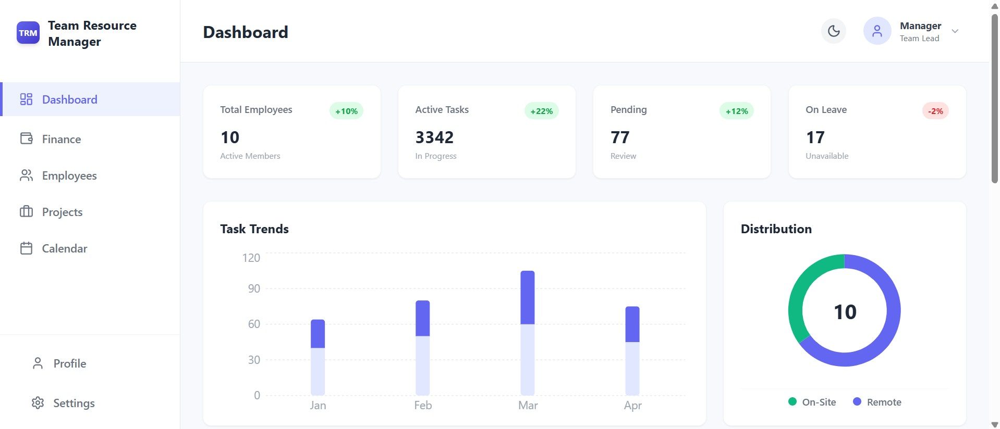
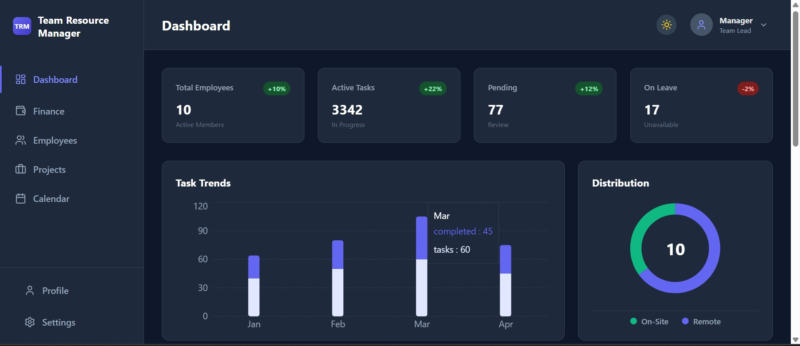

# Team Resource Manager (TRM)

[](https://openjdk.org/projects/jdk/21/)
[](https://spring.io/projects/spring-boot)
[](https://vaadin.com/)
[](https://react.dev/)
[](https://tailwindcss.com/)
[](https://www.postgresql.org/)
[](https://www.docker.com/)
[](https://team-resource-manager.vercel.app)
[](https://team-resource-backend.onrender.com)

A Full-Stack Enterprise Customer and Resource Management (CRM) platform engineered for managing talent, cross-functional sprints, budget ledgers, and team scheduling. Designed with a dual UI architecture: a pure Java server-driven **Vaadin Flow** portal alongside a high-velocity **React + TypeScript + Tailwind CSS** SPA, backed by a unified **Spring Boot 3.4** backend.

---

## 🌐 Live Deployments

| Component | Provider | Live URL |
|---|---|---|
| **Frontend Web App** | Vercel | [team-resource-manager.vercel.app](https://team-resource-manager.vercel.app) |
| **Backend API & Portal** | Render | [team-resource-backend.onrender.com](https://team-resource-backend.onrender.com) |

### 🔐 Demo Credentials
* **Email:** `admin@trm.com`
* **Password:** `admin123`
* **Role:** Enterprise Manager
* *(Tip: You can click the **"Fill demo credentials"** button directly on the login page for 1-click access.)*

---

## 📸 Screenshots

| **Dashboard Analytics** | **Dark Mode View** |
|:---:|:---:|
|  |  |

---

## ✨ Key Features

- **Interactive Global Quick Bar (`Ctrl+K` / `⌘K`):**
  - Instant searchable omnibar in the navbar with live autocomplete suggestions.
  - Quick-jump across Pages, Talent records, Sprint Projects, and Ledger Transactions.
  - Complete keyboard navigation (<kbd>↑</kbd> / <kbd>↓</kbd> / <kbd>Enter</kbd> / <kbd>Esc</kbd>).

- **Talent & Workforce Directory:**
  - Complete employee lifecycle management with discipline scores, department allocations, compensation tiers, and work mode filters (`Remote`, `Hybrid`, `On-Site`).
  - Real-time search and filter queries backed by Spring Data JPA.

- **Projects & Sprints Kanban Board:**
  - Modern Kanban board (`To Do`, `In Progress`, `Done`) with uniform cards and status indicators.
  - Budget allocation tracking, deadline countdowns, and progress percentages.

- **Finance & Budget Ledger:**
  - Comprehensive revenue, expense, and client retainer tracking.
  - Visual financial analytics, categorization, and transaction auditing.

- **Calendar & Milestone Scheduling:**
  - Timeline coordination for architecture reviews, sprint demos, and quarterly financial syncs.
  - Automatically centers on the current date by default.

- **Stateless JWT Security (Spring Security 6):**
  - BCrypt password hashing, stateless session management, and fine-grained role-based endpoint permissions.
  - Built-in resilience against cloud cold-starts with automatic demo session fallback.

- **Optimized Cloud Memory Footprint:**
  - Ultra-lean JVM ergonomics (`-Xms64m -Xmx220m -XX:+UseSerialGC`) and HikariCP connection tuning, running smoothly at under 250 MB RAM on Render's 512 MB free tier without OOM kills.

---

## 🛠️ Tech Stack & Architecture

```
                       ┌───────────────────────────────────────────────┐
                       │          Client Interfaces (UI Layer)         │
                       ├──────────────────────┬────────────────────────┤
                       │ React 18 + Vite SPA  │ Vaadin Flow 24.5       │
                       │ (Tailwind, Lucide,   │ (Pure Java Server-     │
                       │  Zustand, Recharts)  │  Driven UI & Layouts)  │
                       └───────────┬──────────┴────────────┬───────────┘
                                   │                       │
                                   │ REST APIs             │ Vaadin RPC /
                                   │ (/api/v1/**)          │ WebSockets
                                   ▼                       ▼
                       ┌───────────────────────────────────────────────┐
                       │          Spring Boot 3.4.2 Backend            │
                       ├───────────────────────────────────────────────┤
                       │  • Spring Security 6 (Stateless JWT Filter)   │
                       │  • Spring Data JPA & Hibernate 6 ORM          │
                       │  • Flyway Database Versioning Migrations      │
                       │  • HikariCP Connection Pool (Lean Capped)     │
                       └───────────────────────┬───────────────────────┘
                                               │
                                               ▼
                       ┌───────────────────────────────────────────────┐
                       │               Persistence Layer               │
                       ├──────────────────────┬────────────────────────┤
                       │ PostgreSQL 16 (Prod) │ H2 In-Memory (Dev/Test)│
                       └──────────────────────┴────────────────────────┘
```

### **Backend**
* **Runtime:** OpenJDK 21
* **Framework:** Spring Boot 3.4.2
* **Server-Driven UI:** Vaadin Flow 24.5.9
* **Security:** Spring Security 6, JJWT (io.jsonwebtoken 0.12.6), BCrypt
* **Database & ORM:** Spring Data JPA, Hibernate 6, PostgreSQL JDBC Driver, H2 Database
* **Database Migrations:** Flyway 10
* **Build System:** Apache Maven Wrapper (`mvnw`)

### **Frontend**
* **Framework:** React 18, TypeScript, Vite
* **Styling:** Tailwind CSS, PostCSS, Lucide React
* **State & Forms:** Zustand, React Hook Form, Zod
* **Data Visualizations:** Recharts
* **Notifications:** Sonner Toast Notifications

---

## 🚀 Getting Started Locally

### Prerequisites
* **Java 21** or later installed (`java -version`)
* **Node.js 18+** & npm installed (`node -v`)
* **Git** installed

### 1. Clone the Repository
```bash
git clone https://github.com/0ANSHKUMARSINGH4/Team-Resource-Manager.git
cd "Team-Resource-Manager"
```

### 2. Run the Java Backend & Vaadin Portal
```bash
# Windows
.\mvnw.cmd spring-boot:run

# Linux / macOS
chmod +x ./mvnw
./mvnw spring-boot:run
```
* Backend REST API: `http://localhost:8080/api/v1`
* Vaadin Pure Java Portal: `http://localhost:8080/`
* H2 Database Console: `http://localhost:8080/h2-console` (JDBC URL: `jdbc:h2:mem:trmdb`)

### 3. Run the Modern React Frontend
Open a separate terminal window:
```bash
cd frontend
npm install
npm run dev
```
* Access the React application at: `http://localhost:5173`

---

## 🐳 Docker Deployment

The project includes an optimized multi-stage `Dockerfile` with lean memory constraints:

```bash
# Build the Docker image
docker build -t team-resource-manager:latest .

# Run the container (default port 8080)
docker run -p 8080:8080 \
  -e PORT=8080 \
  -e JWT_SECRET=yourSuperSecret256BitKeyForProductionUseHere \
  team-resource-manager:latest
```

---

## ⚙️ Environment Variables

| Variable | Default Value | Description |
|---|---|---|
| `PORT` | `8080` | HTTP port on which Tomcat listens |
| `DATABASE_URL` | *(Empty / uses H2)* | PostgreSQL database connection string (supports `postgres://` or `jdbc:postgresql://`) |
| `JWT_SECRET` | *(Built-in Dev Key)* | 256-bit secret key used to sign and verify JWT tokens |
| `CORS_ALLOWED_ORIGINS` | `localhost:5173, localhost:3000, team-resource-manager.vercel.app` | Comma-separated list of permitted origins |
| `SPRING_PROFILES_ACTIVE` | `dev` | Active Spring profile (`dev` or `prod`) |

---

## 👥 Contributors

* **Lead Architect & Developer:** [Ansh Kumar Singh](https://github.com/0ANSHKUMARSINGH4)

## 📄 License

This project is licensed under the [MIT License](LICENSE).
